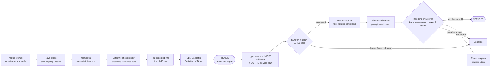
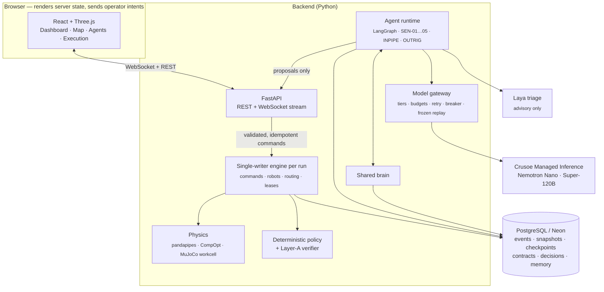

<div align="center">

# Crusoe Cooler System

### AI agent teams that find, repair and *independently prove* the fix in a liquid-cooled data center — in simulation.

<sub>Codename **LOOPKEEPER** · built for the Crusoe × Cerebral Valley Recursive Agents Hackathon · problem statement: **Done Means Done**</sub>

<br/>


<br/>

### [▶ Open the live console](https://loopkeeper-delta.vercel.app)
<sub>Runs in your browser. It connects to the project's live backend when that server is up (the console says so in its status bar); otherwise it falls back to the built-in simulator and labels itself MOCK.</sub>


</div>

---

## The idea in one paragraph

Language models are good at *saying* a problem is fixed. This project makes that claim **testable**. A vague request ("a GPU row is running hot and the water feels wrong") becomes a **machine-checkable Definition of Done** that is *frozen before any repair*. Agents diagnose and delegate; deterministic code drives the robots and enforces safety; the physics engine re-measures the plant; and an **independent verifier** that cannot override the numbers decides whether the repair worked. A failed repair is rejected and re-planned — never repainted green.

> *"Agents write their own physical completion tests, delegate repairs, catch their failed attempts, and stop only on independent verified recovery or safe escalation."*

## How a request becomes a verified repair



**The rule that makes it honest:** only independent physical evidence can produce `VERIFIED`. Every other ending is named — `PARTIAL`, `CONTAINED_NOT_REPAIRED`, `ESCALATED`, `FAILED`, `TIMED_OUT`, `UNKNOWN`. A solver that does not converge is `UNKNOWN`, never `PASS`. The reviewing model can ask for more tests or a replan, but it can never force a pass.

## What is in the box

<table>
<tr>
<td width="50%" valign="top">

### A physically coupled facility
- 5 rack rows × 8 racks, four service roads, CDU + mechanical bay
- Two **separate** water loops (facility water, technology cooling) that exchange heat through the CDU and never mix
- Hydraulics: [pandapipes](https://github.com/e2nIEE/pandapipes) (quasi-steady)
- Chip / rack / coolant thermals: [CompOpt](https://github.com/HewlettPackard/compopt)
- A topology validator checks every rack has a closed supply→return path, no dangling pipes, loops disjoint

</td>
<td width="50%" valign="top">

### Real faults, real consequences
- Fouling, strainer blockage, stuck valve, pump wear, sensor drift, workload surge
- Entered as solver parameters — closing a valve or clogging a pipe changes solved flow and temperature
- Anything the engine cannot model (fire, power loss…) is reported as **unsupported**, not faked

</td>
</tr>
<tr>
<td valign="top">

### 18 robots, 5 supervisors
- **10 INPIPE** crawlers in serviceable pipe branches, **8 OUTRIG** manipulators (two per road)
- Route graphs, time-window reservations, deadlock handling, swept-collision checks
- **5 SENTINEL** supervisors are virtual (no robot body): goal architect, INPIPE coordinator, OUTRIG coordinator, safety arbiter, independent verifier

</td>
<td valign="top">

### Governed authority
- **L0** observe · **L1** reversible cleaning · **L2** isolated service · **L3** high-impact (human approval required)
- Every action is checked twice: at the tool boundary and again when the engine commits it
- A model saying "approved" is never authority

</td>
</tr>
<tr>
<td valign="top">

### Shared brain
- Verified lessons and facts in PostgreSQL, with provenance and expiry
- A lesson from a **failed** run is never promoted; conflicting evidence keeps both revisions
- Switchable, so memory on/off can be A/B tested

</td>
<td valign="top">

### Replayable, forkable history
- Event-sourced runs, LangGraph checkpoints in Postgres (tested on Neon)
- Scrub a run, **fork** it at any checkpoint; replay never calls a model again
- Live takeover uses exclusive leases with safe-hold on disconnect

</td>
</tr>
</table>

## See it

| Map — cameras, layers, robot roster, manual control | Agents — delegation graph, tool calls, verdicts |
|---|---|
|  |  |

| Execution — scenario launcher, replay, fork, communications, Definition of Done |
|---|
|  |

Four tabs, nothing else: **Dashboard · Map · Agents · Execution**. Every panel can be hidden and reopened without stopping the simulation, and the console degrades to a text/2D shell on phones and devices without WebGL.

## Architecture



- **The engine is the only writer of world state.** Agents and the browser submit validated, idempotent commands.
- **Nothing in the control loop waits on a model.** Routing, collision avoidance, motion and the thermal solver are deterministic; an unavailable model produces a clearly labelled deterministic fallback.
- **Model tiers, measured on the project's Crusoe account:** Nemotron-3-Nano (about 0.3–0.9 s per call) for frequent perception and classification; Nemotron-3-Super-120B (about 1–5 s) for reconciliation, planning, verification review and escalation. Reasoning mode is off by default — with it on, the 120B model took 13 s and produced whitespace at small token caps.
- **Every accepted model decision is stored and frozen**, so a replay is deterministic and costs nothing.

## Evidence (what has actually been measured)

| What | Result |
|---|---|
| Backend test suite | **566 passed**, 4 skipped (need a live database or key) |
| Frontend tests | 61 core + 46 web passing; typecheck and production build clean |
| Topology gates | 5 rows × 8 racks, 4 roads, 40 rack coolant paths, loops disjoint, no pipe stubs — all automated |
| Real-model incident (strainer fault, in-process harness) | classify/review on Nano, intervention/verify on Super; resolved with 7 frozen decisions and 0 failed calls |
| Postgres checkpoint resume | graph interrupted at an approval node, resumed by a fresh process from the database |
| Multi-robot stress (8 outrigs + 10 crawlers, blocked aisle, closed pipe) | Jain fairness 0.94–0.999 over three seeds, no overlaps, no failed missions |
| Evaluation harness | 9 scenarios × 10 held-out seeds × 3 agent setups, replay identical on 180/180 runs; first arms cost $0.055 in model calls — see [`docs/engineering/V11_EVAL.md`](docs/engineering/V11_EVAL.md) |
| Laya triage | benchmarked on 48 cases: raw accuracy 0.33, so it stays **advisory**; a deterministic safety override routes unsafe requests to a human 4/4 |

The scorecard, its denominators and its caveats (for example, that the effective sample is smaller than the seed count because seeds barely vary model output) live in [`docs/engineering/V11_EVAL.md`](docs/engineering/V11_EVAL.md). Nothing here is a claim about a real plant.

## Quick start

Requirements: Node 22+, pnpm 9, Python 3.11–3.13, [uv](https://docs.astral.sh/uv/).

```bash
pnpm install
cp .env.example .env        # fill in what you have; every key is optional

# A) Console + built-in simulator — no backend, no keys (labelled MOCK in the UI)
pnpm dev:standalone

# B) Full stack: Python engine + API + console
(cd backend && uv sync)
pnpm dev                    # API :8787 · web :5173
```

No database → in-memory runs. No `CRUSOE_API_KEY` → deterministic fallback, shown as "model unavailable". Add `DATABASE_URL` for persistence and the key for live Nemotron.

<details>
<summary><b>Configuration</b></summary>

| Variable | Purpose |
|---|---|
| `CRUSOE_API_KEY`, `MODEL_BASE_URL` | Crusoe Managed Inference (OpenAI-compatible). The key stays server-side |
| `MODEL_NAME`, `MODEL_NAME_DEEP`, `MODEL_SEED`, `MODEL_THINKING` | Fast and deep model tiers, seed, reasoning switch |
| `DATABASE_URL` (+ `DATABASE_URL_UNPOOLED`) | Pooled URL for the API; direct URL for migrations and checkpoints |
| `API_HOST`, `API_PORT`, `CORS_ALLOW_ORIGINS` | Binding and allowed browser origins |
| `API_AUTH_TOKEN`, `API_AUTH_DISABLED` | Bearer-token auth. **Never expose the API with auth disabled** |
| `WORLD_SEED`, `SIM_SPEED_MULTIPLIER` | Deterministic runs and simulation speed |
| `MEMORY_ENABLED` | Turn the shared brain on |

Only `VITE_*` variables reach the browser.
</details>

<details>
<summary><b>Tests</b></summary>

```bash
pnpm typecheck
pnpm test                                       # core simulator + contracts
pnpm --filter @loopkeeper/web test              # web unit tests
uv run --project backend pytest backend/tests   # backend (about 20 minutes)
```
</details>

## Repository map

```
backend/        physics · engine · robots · navigation · agents · inference gateway · memory · eval · API · storage
packages/core   typed contracts, stores, API clients, embedded dev simulator
packages/scene  React Three Fiber facility scene (instanced racks, pipes, robot rigs)
apps/web        the four-tab console          apps/mobile  Expo app          apps/mock-api  dev API
docs/           decisions · progress · acceptance reports · protocol · demo script · provenance
scripts/        local run, preflight, benchmark and end-to-end helpers
```

Start with [`DECISIONS.md`](DECISIONS.md) (why it is built this way) and [`PROGRESS.md`](PROGRESS.md) (what is verified and what is not). The agent message format is in [`docs/engineering/V10_COMMUNICATION_PROTOCOL.md`](docs/engineering/V10_COMMUNICATION_PROTOCOL.md); the completion-contract design is in [`docs/engineering/V11_DOD.md`](docs/engineering/V11_DOD.md).

## Honest limits

- **It is a simulation.** Hydraulics are quasi-steady (not CFD), thermals are lumped, robot cleaning and manipulation use documented simplified models. Nothing here controls real equipment.
- Power failure, fire and chiller loss are **not modelled**; those scenarios are reported as proxies or unsupported.
- Frame-rate numbers so far come from headless runs on a server GPU, not from a high-refresh display — no 120/200 FPS claim is made.
- Phones are covered by emulation only; no physical device testing yet.
- The mobile Expo app has not been updated for the four-tab layout.
- Laya's checkpoint ships calibration values that its own library flags; it is used as an advisory signal only.

## License and provenance

MIT — see [`LICENSE`](LICENSE). Third-party components keep their licenses: [`THIRD_PARTY_NOTICES.md`](THIRD_PARTY_NOTICES.md). This repository is a clean export of a private development repository; see [`docs/PROVENANCE.md`](docs/PROVENANCE.md) and [`docs/submission/PROVENANCE_EVENT.md`](docs/submission/PROVENANCE_EVENT.md) for what predates the hackathon and what was built during it.
