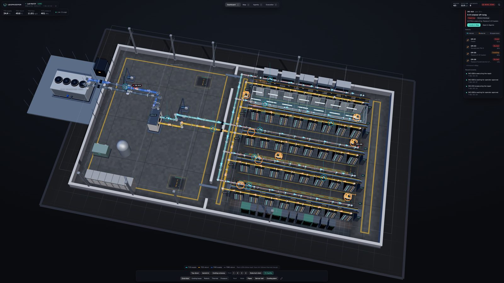
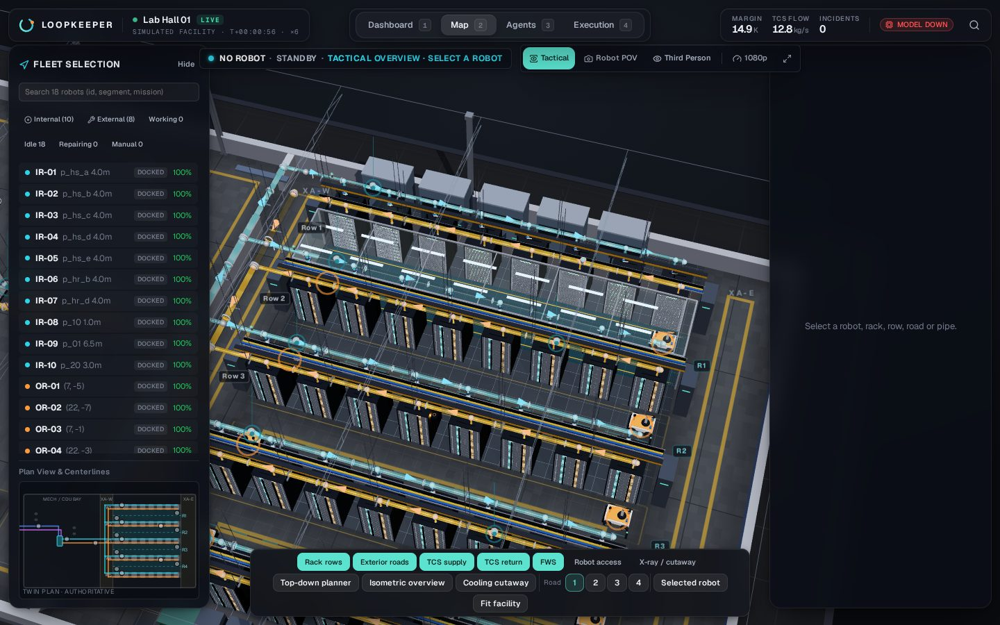
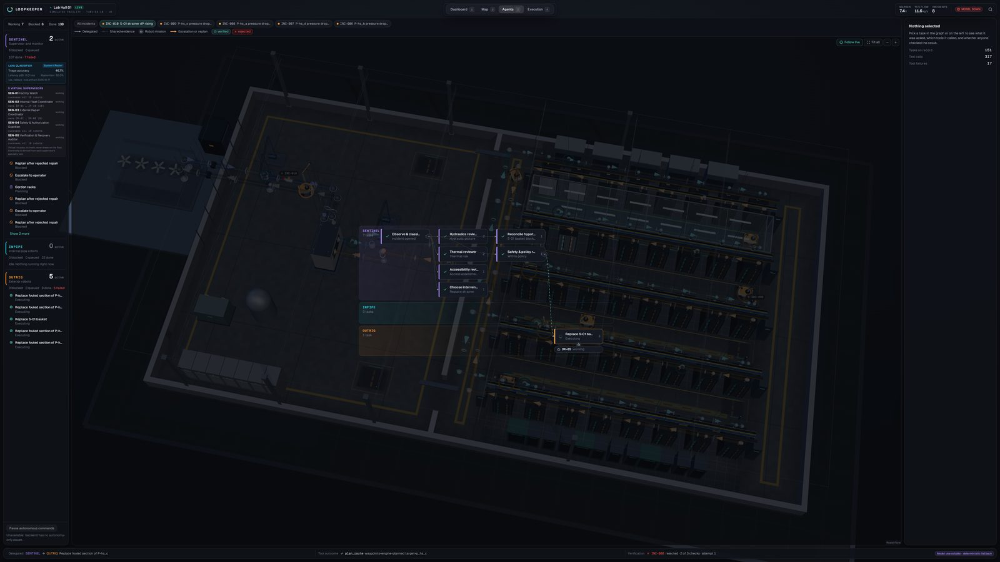
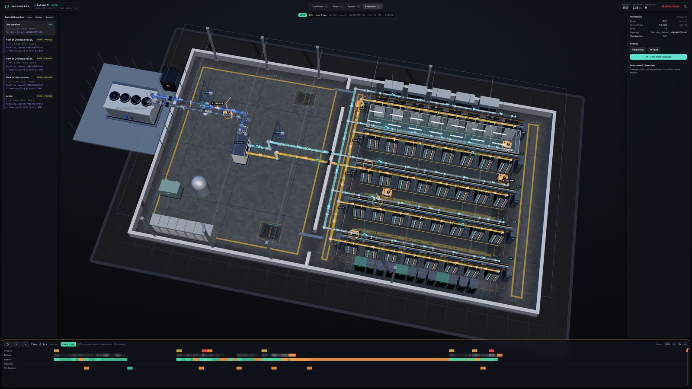

# LOOPKEEPER

**A virtual liquid-cooled AI data center where teams of AI agents and robots find, repair and *independently verify* cooling failures.**

LOOPKEEPER is a simulated facility, not a control system for a real plant. It is built around one idea: **"done" has to be proven by physics,
not claimed by an agent.** Agents propose and delegate; deterministic code moves the robots, enforces safety, and re-measures the plant;
a separate verifier decides whether a repair actually worked.



## What it does

- **A physically coupled facility.** 5 rack rows × 8 racks, four service roads, a CDU and mechanical bay. Two separate water loops
  (facility water and technology cooling) exchange heat through the CDU and never mix. Hydraulics are solved with
  [pandapipes](https://github.com/e2nIEE/pandapipes) (quasi-steady, not CFD); chip, rack and coolant thermals use
  [CompOpt](https://github.com/HewlettPackard/compopt) models behind adapters.
- **Real faults.** Fouling, strainer blockage, stuck valves, pump wear, sensor drift and workload spikes enter through valid solver parameters.
  Closing a valve or clogging a pipe changes solved flow and temperature; nothing is a canned animation.
- **A fleet of virtual robots.** 10 in-pipe crawlers and 8 exterior maintenance robots (two per road) move on validated route graphs with
  reservations and collision checks, and report 3D poses. Servicing is done by tools with preconditions (isolation, reach, battery, parts).
- **Five supervisor agents plus mission agents.** SENTINEL supervisors (virtual — no robot body) diagnose, delegate to INPIPE/OUTRIG mission
  agents, and request actions. LLM calls (Crusoe-hosted NVIDIA Nemotron) happen only at decision boundaries; routing, control and safety
  never wait on a model. If the provider is unavailable the system falls back to a labelled deterministic policy.
- **Governed repairs.** Actions are graded L0 (observe) to L3 (high impact). A deterministic policy checks every action twice
  (at the tool boundary and again when the engine commits it); L3 needs explicit human approval. A model saying "approved" is never authority.
- **Independent verification.** After a repair the plant is re-measured against frozen criteria; a failed check is rejected and replanned,
  not repainted green.
- **Durable and replayable.** Runs, events, snapshots and agent checkpoints persist in PostgreSQL (tested on Neon) with LangGraph
  checkpointing. History is event-sourced: scrub a run, fork it at any checkpoint, and replay it without re-calling a model.
- **Human control.** Exclusive control leases for live takeover (safe-hold on disconnect), plus a non-authoritative "ghost" preview drive.

## The four tabs

| Tab | What it is for |
|---|---|
| **Dashboard** | Live facility overview, health strip, current incident, fleet summary |
| **Map** | 3D map with cameras, layer toggles, robot roster, first/third-person views and manual control |
| **Agents** | Supervisor roles, delegation graph, tool calls with evidence, approvals and verification results |
| **Execution** | Scenario launcher, replay and fork, timeline, run details |

| Map | Agents | Execution |
|---|---|---|
|  |  |  |

## Architecture

```
 browser (React + Three.js)  ──REST/WebSocket──▶  FastAPI  ──commands──▶  single-writer engine (per run)
   renders server state only                         │                      ├─ pandapipes hydraulics + CompOpt thermals
   sends operator intents                            │                      ├─ robots, route graphs, reservations, MuJoCo workcell
                                                     │                      └─ deterministic policy + verifier (no LLM)
                                                     ▼
                                         agent runtime (LangGraph) ──▶ Crusoe Managed Inference (Nemotron)
                                                     │
                                                     ▼
                                         PostgreSQL / Neon: events, snapshots, checkpoints, decisions
```

* The engine is the only writer of world state; agents and the browser submit validated, idempotent commands.
* The simulation keeps running with the browser closed; the browser interpolates server poses and never invents motion.
* Model tiers (measured on the author's account): a small Nemotron model for frequent classification/perception decisions, the 120B Nemotron for
  reconciliation, planning, verification and escalation. Every accepted decision is stored and frozen, so replay never calls a model.

## Quick start

Requirements: Node 22+, pnpm 9, Python 3.11–3.13, [uv](https://docs.astral.sh/uv/).

```bash
pnpm install
cp .env.example .env            # then edit; see "Configuration"

# A) Web console with the built-in simulator (no backend, no keys) — labelled MOCK in the UI
pnpm dev:standalone

# B) Full stack: Python engine + API + web console
(cd backend && uv sync)
pnpm dev                        # API on :8787, web on :5173
```

The backend runs without a database (in-memory, for experimenting) and without a model key (deterministic fallback, shown as
"model unavailable" in the UI). Set `DATABASE_URL` for persistence and `CRUSOE_API_KEY` for live inference.

### Configuration

| Variable | Purpose |
|---|---|
| `CRUSOE_API_KEY`, `MODEL_BASE_URL` | Crusoe Managed Inference (OpenAI-compatible); the key stays server-side |
| `MODEL_NAME`, `MODEL_NAME_DEEP`, `MODEL_SEED`, `MODEL_THINKING` | Fast and deep model tiers; reasoning off by default |
| `DATABASE_URL` (+ `DATABASE_URL_UNPOOLED`) | PostgreSQL; use the pooled URL for the API and the direct URL for migrations and checkpoints |
| `API_HOST`, `API_PORT`, `CORS_ALLOW_ORIGINS` | API binding and allowed browser origins |
| `API_AUTH_TOKEN` / `API_AUTH_DISABLED` | Bearer-token auth for the API. **Do not expose the API publicly with auth disabled.** |
| `WORLD_SEED`, `SIM_SPEED_MULTIPLIER` | Deterministic runs and simulation speed |

Only `VITE_*` variables are ever exposed to the browser; secrets never are.

## Tests

```bash
pnpm typecheck                                  # all TypeScript projects
pnpm test                                       # core simulator / contract tests
uv run --project backend pytest backend/tests   # backend (a few minutes)
```

At the last full run: TypeScript 61 tests passing; backend 351 passed, 4 skipped (the skips need a real database or provider key). The
topology, safety and replay gates are listed in [`docs/engineering/v6-acceptance.md`](docs/engineering/v6-acceptance.md).

## Repository layout

```
backend/        Python: physics, engine, robots, navigation, agents, intelligence (model client, Laya), API, storage
packages/core   TypeScript contracts, stores, API clients, and the embedded dev simulator
packages/scene  React Three Fiber facility scene shared by web and mobile
apps/web        Web console (Vite + React)      apps/mobile  Expo app      apps/mock-api  dev API for the simulator
docs/           Architecture notes, decisions, acceptance reports, deployment, performance
scripts/        Local run, tunnel and benchmark helpers
```

Start with [`DECISIONS.md`](DECISIONS.md) (why things are the way they are) and [`PROGRESS.md`](PROGRESS.md) (what is verified, what is not).

## Status and honest limits

Working and tested: the five-row hall with closed cooling circuits and a topology validator, solver-backed fault response, robot routing and
traffic, the agent flow from detection to independent verification on the deterministic and the live-model paths, Neon persistence with
LangGraph checkpoint resume, replay and fork, and the four-tab console.

In progress or not yet verified: the fairness of multi-robot traffic under heavy load, the Communications panel and executable
"definition of done" contracts, a full mobile layout, measured frame rates on real high-refresh displays (benchmarks so far are headless),
and the Laya classifier (an advisory component whose accuracy is still being measured). The mobile app has not been updated for the four-tab layout.

Limits to keep in mind: hydraulics are quasi-steady, thermals are lumped, robot cleaning and manipulation use documented simplified
models, and none of this controls real equipment.

## License

MIT — see [`LICENSE`](LICENSE). Third-party components keep their own licenses: [`THIRD_PARTY_NOTICES.md`](THIRD_PARTY_NOTICES.md),
[`docs/engineering/upstreams.md`](docs/engineering/upstreams.md). Provenance of this export: [`docs/PROVENANCE.md`](docs/PROVENANCE.md).
