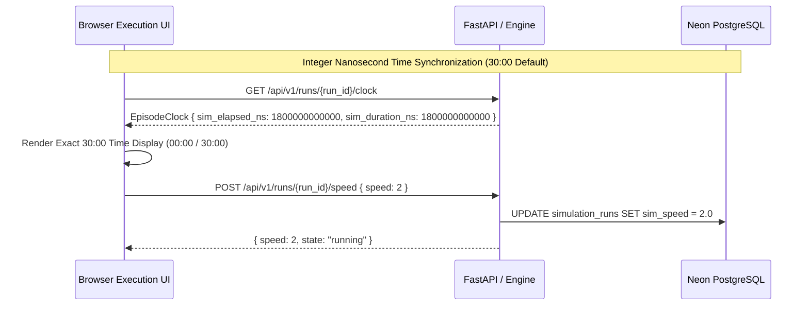

# LOOPKEEPER V8 — Time, Replay, & Counterfactuals

## 1. Nanosecond Integer Time Domain

LOOPKEEPER V8 models all simulation time using an exact integer nanosecond clock (`EpisodeClock`):
- Nominal step duration ($\Delta t$): $0.5\text{ seconds} = 500{,}000{,}000\text{ ns}$.
- Standard scenario horizon ($30:00$): $1{,}800\text{ seconds} = 1{,}800{,}000{,}000{,}000\text{ ns}$ ($3600\text{ ticks}$).
- Pacing multipliers:
  - $1\times$: Real-time synchronized step execution.
  - $2\times$: Accelerated $2\times$ simulation cadence.
  - $3\times$: High-throughput headless batch/evaluation mode.

---

## 2. Deterministic Replay vs. Forking

- **Replay Mode**: Replay windows serve pre-computed world snapshots and append-only event logs. Scrubbing backwards or forwards is an instantaneous, zero-cost operation that updates the 3D facility pose without re-running differential equation solvers or LLM inference.
- **Counterfactual Branching (Forking)**:
  - Operators can inspect a past failure at any tick (e.g., tick 720).
  - Clicking **"Fork from Playhead"** creates an isolated child run pointing to `parent_run_id` and `fork_tick`.
  - The parent run's event log and cryptographic snapshot hashes remain 100% immutable.
  - Alternative intervention policies (e.g., duty swap vs. immediate shutdown) are executed on the branched state to produce contrasting causal verdicts.
